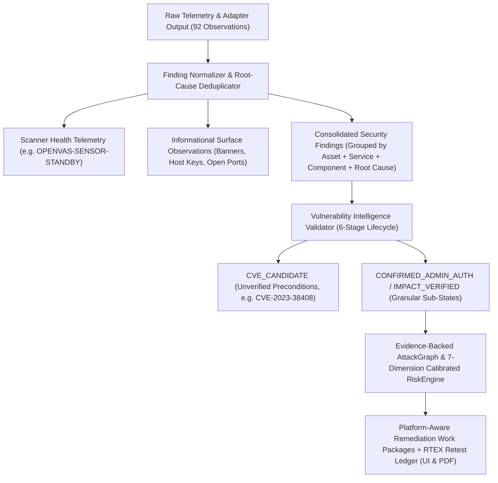

# TrePath 2.1 — Enterprise Security Assessment Engine Developer Specification

> [!IMPORTANT]
> This specification translates every finding from the **TrePath 2.0 Security Assessment Review (`192.168.195.139`)** into concrete engineering requirements and automated acceptance tests while preserving all working TrePath 2.0 safe PoC probes, telemetry, and PDF reporting capabilities.

---

## 1. Executive Summary of TrePath 2.1 Upgrades

| Priority | Subsystem | Primary Files | Core Critique Addressed |
| :--- | :--- | :--- | :--- |
| **P0.1** | **Finding Intelligence & Deduplication Engine** | [finding_normalizer.py](file:///D:/Anti-gravity/expedite-consults/platforms/trepath-2.0/backend/app/finding_normalizer.py), [reporting/__init__.py](file:///D:/Anti-gravity/expedite-consults/platforms/trepath-2.0/backend/app/reporting/__init__.py) | Stops counting 92 raw observations as 92 vulnerabilities; merges duplicate service/banner/CVE records by root cause; moves `OPENVAS-SENSOR-STANDBY` to Scanner Coverage; emits 6 distinct executive counts. |
| **P0.2** | **Granular Impact Verification & Proof Taxonomy** | [smb_share_probe.py](file:///D:/Anti-gravity/expedite-consults/platforms/trepath-2.0/backend/app/testing/adapters/smb_share_probe.py), [phpinfo_probe.py](file:///D:/Anti-gravity/expedite-consults/platforms/trepath-2.0/backend/app/testing/adapters/phpinfo_probe.py), [tomcat_manager_probe.py](file:///D:/Anti-gravity/expedite-consults/platforms/trepath-2.0/backend/app/testing/adapters/tomcat_manager_probe.py) | Splits SMB proof levels (`SHARE_ENUMERATION_VERIFIED` vs `SHARE_READ_VERIFIED` vs `WRITE_ACCESS_VERIFIED`); classifies `phpinfo.php` directives by disclosure type; adds `CONFIRMED_ADMIN_AUTH` for Tomcat Manager; generates Linux/Samba `smb.conf` remediation instead of Windows Registry keys. |
| **P0.3** | **CVE Applicability & Precondition Validator** | [intel_matcher.py](file:///D:/Anti-gravity/expedite-consults/platforms/trepath-2.0/backend/app/intel_matcher.py), [models.py](file:///D:/Anti-gravity/expedite-consults/platforms/trepath-2.0/backend/app/models.py) | Implements 6-stage lifecycle (`VERSION_DETECTED` → `CVE_CANDIDATE` → `APPLICABILITY_VALIDATED` → `PRECONDITIONS_VALIDATED` → `EXPLOITABILITY_VALIDATED` → `IMPACT_VERIFIED`) so banner-only matches like `CVE-2023-38408` on OpenSSH 4.7 are marked as precondition-unverified candidates. |
| **P0.4** | **Evidence-Driven AttackGraph Engine** | [attack_graph/__init__.py](file:///D:/Anti-gravity/expedite-consults/platforms/trepath-2.0/backend/app/attack_graph/__init__.py) | Classifies every graph edge (`OBSERVED`, `INFERRED`, `PRECONDITION_CONFIRMED`, `TECHNIQUE_VALIDATED`, `EXECUTED`, `IMPACT_VERIFIED`) and prevents unverified multi-service correlations from being labeled `ATTACK_PATH_VALIDATED`. |
| **P1.5** | **Explainable 7-Dimension RiskEngine** | [risk/__init__.py](file:///D:/Anti-gravity/expedite-consults/platforms/trepath-2.0/backend/app/risk/__init__.py) | Replaces opaque risk numbers with a reproducible 7-dimension score table traceable to consolidated findings and verified evidence confidence. |
| **P1.6** | **Traceable Remediation & Retest Ledger** | [remediation/__init__.py](file:///D:/Anti-gravity/expedite-consults/platforms/trepath-2.0/backend/app/remediation/__init__.py), [pdf_generator.py](file:///D:/Anti-gravity/expedite-consults/platforms/trepath-2.0/backend/app/reporting/pdf_generator.py), [pdfReportBuilder.ts](file:///D:/Anti-gravity/expedite-consults/platforms/trepath-2.0/frontend/src/pdfReportBuilder.ts) | Maps every work package to `affected_finding_ids`, `verification_test`, `closure_criteria`, platform-specific fixes, and renders the `RTEX-xxxxx` Retest Ledger in the UI Report tab and exported PDF. |

---

## 2. Architecture & Proof-State Flow

---

## 3. Detailed Engineering Requirements

### 3.1 P0.1 — Finding Deduplication & 6-Tier Executive Metrics
1. **Root-Cause Consolidation Key**:
   Group raw findings by `(asset_id, service_port, normalized_component, root_cause_family)` and store merged raw records inside `supporting_observations` in the finding's evidence payload:
   - **FTP (`21/tcp`)**: Consolidate vsFTPd service fingerprint + banner + duplicate `CVE-2011-2523` entries into a single finding with multiple supporting evidence records.
   - **SSH (`22/tcp`)**: Consolidate OpenSSH 4.7p1 service + banner + host key into a single outdated-service finding, with `CVE-2023-38408` tracked as an attached `CVE_CANDIDATE`.
   - **HTTP (`80/tcp`)**: Consolidate duplicate Apache `2.2.8 (Ubuntu) DAV/2` observations across Nmap, httpx, and Nuclei.
   - **MySQL (`3306/tcp`)**: Consolidate MySQL service discovery and version banner (`5.0.51a-3ubuntu5`).
2. **Six-Tier Executive Counts**:
   - `raw_scanner_observations` (e.g., `92`)
   - `unique_assets_and_services` (e.g., `1 host / 16 open ports / 10 endpoints`)
   - `unique_security_findings` (consolidated control deficiencies)
   - `confirmed_exploitable_findings` (`EXPLOITABILITY_VALIDATED` + `CONFIRMED_ADMIN_AUTH` + `IMPACT_VERIFIED`)
   - `impact_verified_findings` (`SHARE_ENUMERATION_VERIFIED`, `SHARE_READ_VERIFIED`, `CONFIG_AND_PATH_DISCLOSURE_VERIFIED`, `ADMIN_CONSOLE_ACCESS_VERIFIED`)
   - `informational_observations` (port/banner/key inventory)
3. **Operational Status Isolation**:
   - Move `OPENVAS-SENSOR-STANDBY` out of the vulnerability table into a dedicated **Scanner Health & Assessment Coverage** section.

---

### 3.2 P0.2 — Granular Proof Taxonomy & Platform-Aware Remediation
1. **SMB Proof Split ([smb_share_probe.py](file:///D:/Anti-gravity/expedite-consults/platforms/trepath-2.0/backend/app/testing/adapters/smb_share_probe.py))**:
   - `SMB-LIST-001` (`smbclient -L //<host> -N -p 445`) sets `proof_state = "IMPACT_VERIFIED"` with `proof_substate = "SHARE_ENUMERATION_VERIFIED"`. Its impact statement strictly claims **anonymous session establishment and share name/comment enumeration** (`IPC$`, `ADMIN$`, `print$`, `tmp`) and explicitly notes that share read/write access requires separate share-level verification.
   - Add read-only share access verification (`SMB-READ-001`: `smbclient //<host>/tmp -N -p 445 -c "ls"`), which promotes the proof substate to `SHARE_READ_VERIFIED` only when directory contents are actually returned.
   - **Linux / Samba Remediation**: When the asset OS/fingerprint indicates Linux/Ubuntu/Samba (`192.168.195.139`), output Samba `/etc/samba/smb.conf` hardening (`map to guest = Never`, `restrict anonymous = 2`, `guest ok = no`, `read only = yes`) instead of Windows `RestrictAnonymous` registry keys.
2. **PHPInfo Structured Disclosure Classification ([phpinfo_probe.py](file:///D:/Anti-gravity/expedite-consults/platforms/trepath-2.0/backend/app/testing/adapters/phpinfo_probe.py))**:
   - Parse and classify exposed directives into three explicit buckets inside the evidence transcript:
     - `configuration_disclosure`: `allow_url_include=On`, `allow_url_fopen=On`, `register_globals`, `expose_php=On`
     - `internal_path_disclosure`: `DOCUMENT_ROOT=/var/www`, `Loaded Configuration File`, `extension_dir`
     - `environment_and_secret_disclosure`: Server software, kernel uname, environment variables (`$_ENV` / `$_SERVER`)
3. **Tomcat Manager Administrative Access State ([tomcat_manager_probe.py](file:///D:/Anti-gravity/expedite-consults/platforms/trepath-2.0/backend/app/testing/adapters/tomcat_manager_probe.py))**:
   - Set `proof_state = "CONFIRMED_ADMIN_AUTH"` (with `proof_substate = "ADMIN_CONSOLE_ACCESS_VERIFIED"`).
   - Explicitly document in the finding summary and PDF proof card:
     - **Verified**: Authenticated administrative console access (`tomcat:tomcat` on `/manager/html`) and deployed application inventory visibility.
     - **Not Executed (Safe Lab Boundary)**: WAR package deployment and OS-level command execution were intentionally not executed.

---

### 3.3 P0.3 — CVE Applicability State Machine ([intel_matcher.py](file:///D:/Anti-gravity/expedite-consults/platforms/trepath-2.0/backend/app/intel_matcher.py))
Every CVE match is evaluated through 6 explicit states:
1. `VERSION_DETECTED`
2. `CVE_CANDIDATE` *(default for banner-only version matches with unverified configuration preconditions, such as `CVE-2023-38408` on OpenSSH 4.7 requiring `ssh-agent` PKCS#11 forwarding)*
3. `APPLICABILITY_VALIDATED`
4. `PRECONDITIONS_VALIDATED`
5. `EXPLOITABILITY_VALIDATED`
6. `IMPACT_VERIFIED`

---

### 3.4 P0.4 — Evidence-Driven AttackGraph ([attack_graph/__init__.py](file:///D:/Anti-gravity/expedite-consults/platforms/trepath-2.0/backend/app/attack_graph/__init__.py))
- Every edge in an attack path carries an explicit `edge_evidence_state` (`OBSERVED`, `INFERRED`, `PRECONDITION_CONFIRMED`, `TECHNIQUE_VALIDATED`, `EXECUTED`, `IMPACT_VERIFIED`).
- Paths where transitions between services (`FTP 21` → `MySQL 3306` → `phpMyAdmin 80`) rely on co-location rather than verified credential reuse or pivot execution are labeled `CORRELATED_EXPOSURE_CLUSTER` / `HYPOTHESIZED_ATTACK_PATH`, reserving `ATTACK_PATH_VALIDATED` strictly for chains where every transition is backed by verified evidence.

---

### 3.5 P1.5 & P1.6 — Explainable 7-Dimension Risk Score & Traceable Remediation Ledger
- **Risk Breakdown Table**: Outputs exact point contributions across `Exploitability (25)`, `Impact (20)`, `Exposure (15)`, `Applicable Threat Intel (15)`, `Validated Attack Paths (10)`, `Asset Criticality (10)`, and `Evidence Confidence (5)`.
- **Remediation Work Packages & Retest Ledger**: Every remediation task in the UI Report tab and PDF includes `affected_finding_ids`, `affected_assets`, `platform_target`, `verification_test`, `closure_criteria`, and the live `RTEX-xxxxx` Retest Ledger.
