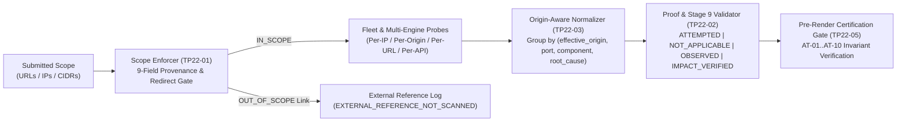

# TrePath 2.2 Developer Specification — Scope Intelligence, Proof Reconciliation & Risk Integrity

> [!IMPORTANT]
> **Release Target**: `TrePath 2.2` (Addressing **Scan #39** Post-Exploitation Report Technical Audit)
> **Scope**: Enforces immutable per-observation asset provenance (`TP22-01`), dynamic proof-state reconciliation (`TP22-02`), port & risk-engine consistency (`TP22-03`), evidence-integrated PoC cards (`TP22-04`), and automated pre-render certification gates (`TP22-05` / `AT-01..AT-10`).

---

## 1. Root-Cause Audit of Scan #39 Defects

| Scan #39 Defect | Root Cause Identified in Codebase | TrePath 2.2 Fix (`TP22-01`..`TP22-05`) |
| :--- | :--- | :--- |
| **1. Scope Contamination & Misattribution (`P0`)**: 46-target scope reported as `1 responsive host (owasp.org)`, while findings for GitHub, Gruyere, PentesterLab, HTB, TryHackMe, and Root-Me were attributed to `owasp.org:80` (`F-05..F-25`, `F-29..F-38`). | [`pdf_generator.py`](file:///D:/Anti-gravity/expedite-consults/platforms/trepath-2.0/backend/app/reporting/pdf_generator.py) and [`pdfReportBuilder.ts`](file:///D:/Anti-gravity/expedite-consults/platforms/trepath-2.0/frontend/src/pdfReportBuilder.ts) rendered `${host_ip}:${port_str}` using only `assets[0].hostname` (`owasp.org`) instead of each finding's true `effective_origin` and `asset_id`. Additionally, crawler links and redirect hops lacked per-hop `scope_decision` provenance records. | Every observation and consolidated finding carries the 9-field **Immutable Asset Provenance Record** (`effective_origin`, `asset_id`, `scope_decision`, `redirect_chain`). External crawled links are logged as `EXTERNAL_REFERENCE_NOT_SCANNED` (`AT-01`), and out-of-scope redirects are blocked (`AT-02`). |
| **2. 183-Finding Inflation (`29` Medium, `154` Low)**: 29 GitHub repository URLs and multiple paths on the same origin produced 150+ separate missing HTTP security header findings. | [`fleet_scanner.py`](file:///D:/Anti-gravity/expedite-consults/platforms/trepath-2.0/backend/app/engines/fleet_scanner.py) (`_scope_finding_to_target`) appended per-URL suffixes (`::T2_...`..`::T46_...`) rather than scoping origin-level controls by **effective origin** (`scheme://hostname:port`). | Consolidate origin-wide controls (HTTP security headers, TLS posture, server banners, CORS, OpenAPI/GraphQL) by `(effective_origin, port, component, root_cause)` (`AT-09`), recording all affected URLs under `affected_endpoints` and `merged_observations_count`. |
| **3. Port Inventory Contradiction (`16` vs `0` Open Ports)**: Cover & Section 2 reported `16 Open TCP Ports`, while Page 3 Risk Decomposition reported `0 open TCP ports + 387 HTTP endpoints`. | In [`pdf_generator.py`](file:///D:/Anti-gravity/expedite-consults/platforms/trepath-2.0/backend/app/reporting/pdf_generator.py) and [`pdfReportBuilder.ts`](file:///D:/Anti-gravity/expedite-consults/platforms/trepath-2.0/frontend/src/pdfReportBuilder.ts), `asset.open_ports` (`[]`) was falsy and fell back to the 16-port Metasploitable array `[21, 22, ..., 8080]`, whereas [`risk/__init__.py`](file:///D:/Anti-gravity/expedite-consults/platforms/trepath-2.0/backend/app/risk/__init__.py) computed `len(asset.open_ports or []) == 0`. | Remove all hardcoded 16-port fallbacks. Reconcile exact open TCP port counts across all in-scope assets in Cover, Executive Summary, Section 2 Asset Reconciliation, and Section 1.4 Risk Decomposition (`AT-08`). |
| **4. Post-Exploitation Proof-State Contradiction (`P0`)**: Report stated `0 CONFIRMED_ADMIN_AUTH` and `0 IMPACT_VERIFIED`, yet Section 1.2, Section 2, Section 5, and Section 10 described `SMB-LIST-001`, `SMB-READ-001`, `PHPINFO-001`, `TOMCAT-MGR-001`, and `Ubuntu 8.04 / Samba 3.0.20` as verified. | Static strings from the single-host `192.168.195.139` lab template remained in [`pdf_generator.py`](file:///D:/Anti-gravity/expedite-consults/platforms/trepath-2.0/backend/app/reporting/pdf_generator.py), [`pdfReportBuilder.ts`](file:///D:/Anti-gravity/expedite-consults/platforms/trepath-2.0/frontend/src/pdfReportBuilder.ts), and [`stage9_validation.py`](file:///D:/Anti-gravity/expedite-consults/platforms/trepath-2.0/backend/app/stage9_validation.py) even when those findings were absent. | Dynamically bind all proof tables, Stage 9 boundary rows, OS fingerprints, and remediation text to the actual findings and test executions of the scan (`AT-03..AT-06`, `AT-10`). |

---

## 2. Architecture & Data Contracts (`TP22-01` through `TP22-05`)

### 2.1 `TP22-01` — Immutable Asset Identity & Scope Provenance Schema
Every scanner observation and consolidated finding carries an immutable provenance record generated by [`evaluate_url_scope_provenance()`](file:///D:/Anti-gravity/expedite-consults/platforms/trepath-2.0/backend/app/scope.py):

| Field | Type | Description & Invariant |
| :--- | :--- | :--- |
| `assessment_scope_id` | `str` | Approved ROE / Engagement scope identifier (e.g., `SCOPE-ENG-0001-ROE-0001`) |
| `requested_url` | `str` | Exact URL submitted to the scanner or discovered via in-scope enumeration |
| `final_url` | `str` | Effective URL after following any authorized HTTP redirects |
| `effective_origin` | `str` | Normalized `scheme://hostname:port` actually contacted (e.g., `https://github.com:443`) |
| `resolved_ip` | `str` | IPv4/IPv6 address contacted or resolved for `effective_origin` |
| `asset_id` | `str` | Deterministic unique asset identity for `effective_origin` (e.g., `ASSET-00010`) |
| `scope_decision` | `str` | `IN_SCOPE` \| `OUT_OF_SCOPE` \| `UNKNOWN` |
| `scope_evidence` | `str` | Exact ROE allowlist entry authorizing the target (or rejection reason if out of scope) |
| `redirect_chain` | `list[dict]` | Ordered list of `{hop, url, effective_origin, scope_decision, scope_evidence}` |

- **External Link Suppression (`AT-01`)**: When [`run_webpulse_enumerator()`](file:///D:/Anti-gravity/expedite-consults/platforms/trepath-2.0/backend/app/discovery/webpulse_enumerator.py) discovers an `<a href>` or `<form action>` pointing to an origin outside `allowed_origins`, it records the URL in `external_references` (`classification="EXTERNAL_REFERENCE_NOT_SCANNED"`, `scope_decision="OUT_OF_SCOPE"`) and never probes or promotes it to an in-scope asset.
- **Redirect Scope Re-Evaluation (`AT-02`)**: Every HTTP redirect hop is validated against `allowed_origins`. If an in-scope URL redirects to an unauthorized external domain, the redirect is halted and logged with `scope_decision="OUT_OF_SCOPE"` and status `REDIRECT_BLOCKED_OUT_OF_SCOPE`.

---

### 2.2 `TP22-02` & `TP22-04` — Proof-State Reconciliation & Evidence-Integrated PoC Cards
Each post-exploitation adapter (`SMB-LIST-001`, `SMB-READ-001`, `PHPINFO-001`, `TOMCAT-MGR-001`, `AUTH-SESSION-001`, `API-AUTHZ-001`, `BOLA-IDOR-001`, `ADMIN-ACCESS-001`) records an explicit execution outcome:
- `NOT_APPLICABLE`: Target does not expose the prerequisite service/port (e.g., TCP/445 closed on web-only target `owasp.org`).
- `ATTEMPTED_NO_EXPOSURE`: Probe executed against target service, control held (e.g., `/phpinfo.php` returned HTTP 404; `/manager/html` returned HTTP 404/401).
- `OBSERVATION_CONFIRMED`: Reachability, banner, or parameter acceptance observed without security boundary violation (`AT-06`: HTTP 200 on `?id=1` and `?id=2` without unauthorized cross-account data diff is `BOLA_CANDIDATE_PARAMETER`, never confirmed IDOR).
- `CONTROL_GAP_CONFIRMED`: Missing defensive control or legacy software version (`AT-07`: version-only CVEs remain `CVE_CORRELATED` unless runtime preconditions are verified).
- `IMPACT_VERIFIED`: Non-destructive technical impact demonstrated (`AT-03`: `SMB-LIST-001` proves `SHARE_ENUMERATION_VERIFIED` only; `SMB-READ-001` required for `SHARE_READ_VERIFIED`; `AT-04`: `PHPINFO-001` proves `CONFIG_AND_PATH_DISCLOSURE_VERIFIED`, never RCE).
- `CONFIRMED_ADMIN_AUTH`: Authenticated administrative access verified (`AT-05`: `TOMCAT-MGR-001` HTTP 200 with valid credentials proves `ADMIN_CONSOLE_ACCESS_VERIFIED`, never RCE unless deployment is separately executed).

---

### 2.3 `TP22-03` — Risk Engine Integrity & Three-Tier Quantity Reporting
1. **Exact Port Inventory Reconciliation (`AT-08`)**:
   - Let `total_open_tcp_ports = sum(len(a.open_ports or []) for a in scan_assets)`.
   - Cover Page, Section 1.1 Tier 2, Section 1.4 Attack Surface Exposure, and Section 2 Asset Reconciliation must all report `total_open_tcp_ports` (never falling back to `16` when `total_open_tcp_ports == 0`).
2. **Origin-Scoped Consolidation (`AT-09`)**:
   - Missing HTTP security headers (`CSP`, `HSTS`, `X-Frame-Options`, `X-Content-Type-Options`, `Referrer-Policy`, `Permissions-Policy`), TLS posture, and origin-wide API/web posture are grouped by `(effective_origin, port, component, root_cause)`.
   - Scanning 29 repository URLs on `https://github.com:443` produces **1** consolidated finding per missing header on `github.com:443` with `merged_observations_count = 29` and `affected_endpoints` listing the 29 paths.
3. **Three Headline Quantities**:
   - **Quantity 1 — Raw Observations**: Total raw records emitted by all scanners (`raw_scanner_observations`).
   - **Quantity 2 — Unique In-Scope Weaknesses**: Consolidated security findings across authorized in-scope assets (`unique_security_findings`).
   - **Quantity 3 — Validated Exploit / Impact Proofs**: Findings with `CONFIRMED_ADMIN_AUTH`, `IMPACT_VERIFIED`, or `RUNTIME_REPRODUCED` (`confirmed_exploitable_findings`).

---

## 3. Mandatory Acceptance Test Suite (`AT-01` through `AT-10`)

| Test ID | Acceptance Requirement | Verification Target |
| :--- | :--- | :--- |
| **`AT-01`** | **External link is not scanned**: Crawling an in-scope page containing `<a href="https://github.com/org/repo">` records an `EXTERNAL_REFERENCE_NOT_SCANNED` entry and produces zero vulnerabilities on `github.com`. | [`scope.py`](file:///D:/Anti-gravity/expedite-consults/platforms/trepath-2.0/backend/app/scope.py), [`webpulse_enumerator.py`](file:///D:/Anti-gravity/expedite-consults/platforms/trepath-2.0/backend/app/discovery/webpulse_enumerator.py) |
| **`AT-02`** | **Redirect out of scope is blocked**: An in-scope URL redirecting (`HTTP 302`) to an unauthorized external domain is blocked with `scope_decision = OUT_OF_SCOPE` and not scanned. | [`scope.py`](file:///D:/Anti-gravity/expedite-consults/platforms/trepath-2.0/backend/app/scope.py), [`safe_dast.py`](file:///D:/Anti-gravity/expedite-consults/platforms/trepath-2.0/backend/app/engines/safe_dast.py) |
| **`AT-03`** | **SMB listing vs file read**: `SMB-LIST-001` sets `SHARE_ENUMERATION_VERIFIED` and explicitly marks file read/write as unproven unless `SMB-READ-001` succeeds. | [`finding_normalizer.py`](file:///D:/Anti-gravity/expedite-consults/platforms/trepath-2.0/backend/app/finding_normalizer.py), [`stage9_validation.py`](file:///D:/Anti-gravity/expedite-consults/platforms/trepath-2.0/backend/app/stage9_validation.py) |
| **`AT-04`** | **phpinfo disclosure vs RCE**: `PHPINFO-001` sets `CONFIG_AND_PATH_DISCLOSURE_VERIFIED` and never claims RCE or `CVE-2012-1823` exploitability from `allow_url_include=On` alone. | [`finding_normalizer.py`](file:///D:/Anti-gravity/expedite-consults/platforms/trepath-2.0/backend/app/finding_normalizer.py) |
| **`AT-05`** | **Tomcat auth vs RCE**: `TOMCAT-MGR-001` sets `CONFIRMED_ADMIN_AUTH` (`ADMIN_CONSOLE_ACCESS_VERIFIED`) and explicitly marks WAR upload / OS execution as `NOT_EXECUTED`. | [`finding_normalizer.py`](file:///D:/Anti-gravity/expedite-consults/platforms/trepath-2.0/backend/app/finding_normalizer.py), [`stage9_validation.py`](file:///D:/Anti-gravity/expedite-consults/platforms/trepath-2.0/backend/app/stage9_validation.py) |
| **`AT-06`** | **BOLA candidate vs confirmed BOLA**: Identical/normal HTTP 200 responses for `?id=1` and `?id=2` without cross-account unauthorized data diff classify as `BOLA_CANDIDATE_PARAMETER` (`low`), never confirmed IDOR. | [`finding_normalizer.py`](file:///D:/Anti-gravity/expedite-consults/platforms/trepath-2.0/backend/app/finding_normalizer.py) |
| **`AT-07`** | **Version-only CVE handling**: Banner-matched CVEs without verified preconditions classify as `CVE_CORRELATED` (`CVE_CANDIDATE`) and have their KEV/EPSS weight discounted 75%. | [`finding_normalizer.py`](file:///D:/Anti-gravity/expedite-consults/platforms/trepath-2.0/backend/app/finding_normalizer.py), [`risk/__init__.py`](file:///D:/Anti-gravity/expedite-consults/platforms/trepath-2.0/backend/app/risk/__init__.py) |
| **`AT-08`** | **Port count reconciliation**: Executive Summary, Asset Reconciliation, and Risk Decomposition report the exact same open TCP port count (e.g., `0` when `open_ports=[]`). | [`pdf_generator.py`](file:///D:/Anti-gravity/expedite-consults/platforms/trepath-2.0/backend/app/reporting/pdf_generator.py), [`pdfReportBuilder.ts`](file:///D:/Anti-gravity/expedite-consults/platforms/trepath-2.0/frontend/src/pdfReportBuilder.ts) |
| **`AT-09`** | **Header consolidation**: Missing HTTP headers across multiple URLs on the same origin consolidate into one finding per header type per origin with `affected_endpoints` count. | [`fleet_scanner.py`](file:///D:/Anti-gravity/expedite-consults/platforms/trepath-2.0/backend/app/engines/fleet_scanner.py), [`finding_normalizer.py`](file:///D:/Anti-gravity/expedite-consults/platforms/trepath-2.0/backend/app/finding_normalizer.py) |
| **`AT-10`** | **Proof-count reconciliation**: Executive Summary, Section 1.2 Proof Table, and Section 5 Post-Exploitation Matrix agree on `CONFIRMED_ADMIN_AUTH`, `IMPACT_VERIFIED`, and `RUNTIME_REPRODUCED` counts, with zero static Metasploitable claims when counts are `0`. | [`pdf_generator.py`](file:///D:/Anti-gravity/expedite-consults/platforms/trepath-2.0/backend/app/reporting/pdf_generator.py), [`pdfReportBuilder.ts`](file:///D:/Anti-gravity/expedite-consults/platforms/trepath-2.0/frontend/src/pdfReportBuilder.ts), [`stage9_validation.py`](file:///D:/Anti-gravity/expedite-consults/platforms/trepath-2.0/backend/app/stage9_validation.py) |
