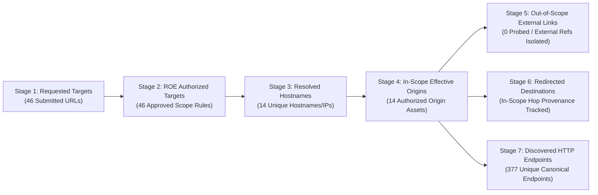

# TrePath 2.3 Engineering Specification — Scan #40 Technical Analysis Resolution, Proof-State Enforcement & Canonical Asset-to-Remediation Integrity

> [!IMPORTANT]
> **Executive Engineering Verdict on Scan #40 (`trepath-post-exploitation-report-scan-40.pdf`)**:
> Scan #40 successfully eliminated cross-domain scope contamination (`14` authorized origin assets `ASSET-00027`..`ASSET-00040`, `0` Port-0 attributions, `181` raw observations consolidated into `17` origin-scoped findings). However, six critical engineering upgrades are required to elevate TrePath from a surface/header hygiene scanner to an **enterprise-grade, high-signal penetration-testing platform**:
> 1. **Proof-State & False-Positive Control (`TP23-01` — P0)**: Prevent route reachability (`F-01` `/web-security/dashboard`), modern version banners (`F-02` `nginx 1.31.8`), anti-bot/honeypot endpoints (`F-13` `/.within.website/x/cmd/anubis/api/honeypot/.../init`), pre-auth login forms (`F-14`), and absent rate-limit telemetry headers (`F-15`) from being overstated as verified control gaps or outdated software vulnerabilities.
> 2. **7-Stage Scope & Asset Reconciliation Funnel (`TP23-02` — P0)**: Explicitly reconcile how `46` submitted URLs map to `46` ROE-authorized URLs, `14` resolved hostnames, `14` in-scope `effective_origin` assets, `0` out-of-scope origins scanned, redirected destinations, and `377` discovered HTTP endpoints.
> 3. **Canonical Finding-to-Remediation Relationship Integrity (`TP23-03` — P0)**: Fix the relational mapping defect in [`backend/app/remediation/__init__.py`](file:///d:/Anti-gravity/expedite-consults/platforms/trepath-2.0/backend/app/remediation/__init__.py) where `generate_remediation_tasks()` bound all `RemediationTask` rows (`REM-00124`..`REM-00138`) to `assets[0]` (`owasp.org`, `ASSET-00027`), causing `F-15` (`github.com:443`) to be assigned to `owasp.org:443` in `REM-00138`.
> 4. **Calibrated Risk Attribution & Sensor Completeness (`TP23-04` — P1)**: Decompose the headline risk score into **Confirmed Compromise (`0.0 pts`)**, **Verified Control Gaps**, and **Surface & Reconnaissance Exposure**, and report **Sensor Coverage Completeness (`83.3%` — 5/6 Active Sensors, OpenVAS Standby)** separately from **Evidence Consistency (`100%` — 5/5 Invariants)**.
> 5. **7-Step Remediation & Retest Verification Loop (`RTEX`) + 6 Negative Quality Gate Tests (`TP23-05` — P1)**: Enforce end-to-end remediation closure verification and automated negative quality gates (`NG-01`..`NG-06`).

---

## 1. Root-Cause Analysis & Resolution Matrix for Scan #40 Findings (`F-01` through `F-17`)

| Scan #40 ID | Target Origin & Asset | Previous Classification (Scan #40) | Technical Root Cause | TrePath 2.3 Enforced Classification & Fix |
| :--- | :--- | :--- | :--- | :--- |
| **`F-01`** | `portswigger.net:443` (`ASSET-00030`) `/web-security/dashboard` | `MEDIUM` (`6.5`) `CONTROL_GAP_CONFIRMED :: LOGIN_INTERFACE_EXPOSED_AUTH_GATE_PRESENT` | [`endpoint_classifier.py`](file:///d:/Anti-gravity/expedite-consults/platforms/trepath-2.0/backend/app/discovery/endpoint_classifier.py) matched substring `/dashboard` as `admin_interface`. [`targeted_dast.py`](file:///d:/Anti-gravity/expedite-consults/platforms/trepath-2.0/backend/app/testing/adapters/targeted_dast.py) treated `HTTP 200` without a `<form>` as `is_unauth_console=True` without verifying privileged admin DOM markers or unauthenticated state actions. | **`LOW` (`3.1`)** `OBSERVATION_CONFIRMED :: LOGIN_INTERFACE_OR_ROUTE_DISCOVERED` Requires verified administrative console markers (`Tomcat Web Application Manager`, `phpMyAdmin`, privileged user/system controls) or auth bypass before promoting to `CONTROL_GAP_CONFIRMED` / `CONFIRMED_ADMIN_AUTH`. |
| **`F-02`** | `pentest-ground.com:443` (`ASSET-00037`) `nginx 1.31.8` | `MEDIUM` (`6.5`) `CONTROL_GAP_CONFIRMED :: CONTROL_MISCONFIGURATION_CONFIRMED` | In [`technology_classifier.py`](file:///d:/Anti-gravity/expedite-consults/platforms/trepath-2.0/backend/app/discovery/technology_classifier.py#L52), `_check_outdated()` had a fallback `version.startswith("1.")` that falsely marked **every** `1.x` version (`nginx 1.31.8`) as `is_outdated=True`! | **`LOW` (`2.5`)** `OBSERVATION_CONFIRMED :: VERSION_FINGERPRINT_BANNER_ONLY` `nginx >= 1.24` (`1.31.8` mainline) is marked `is_outdated=False`. Banner-only fingerprints without verified EOL status or precondition-validated CVEs cannot be promoted to `CONTROL_GAP_CONFIRMED`. |
| **`F-03`–`F-12`, `F-16`, `F-17`** | `12` Authorized Origins (`owasp.org`, `github.com`, `portswigger.net`, etc.) | `MEDIUM` (`5.3`–`6.1`) `CONTROL_GAP_CONFIRMED :: CONTROL_MISCONFIGURATION_CONFIRMED` | Valid origin-consolidated HTTP security header observations, but static scoring did not distinguish public informational pages from authenticated session origins. | **`LOW` / `MEDIUM` Context-Calibrated** `CONTROL_GAP_CONFIRMED :: HTTP_HEADER_BASELINE_GAP` Retains origin-level consolidation (`1` finding per origin) with explicit context note separating defense-in-depth header hygiene from exploitable compromise. |
| **`F-13`** | `www.root-me.org:443` (`ASSET-00035`) `/.within.website/x/cmd/anubis/api/honeypot/.../init` | `MEDIUM` (`5.8`) `OBSERVATION_CONFIRMED :: OBSERVATION_CAPTURED` | [`targeted_dast.py`](file:///d:/Anti-gravity/expedite-consults/platforms/trepath-2.0/backend/app/testing/adapters/targeted_dast.py#L100-L136) (`API-AUTHZ-001`) matched `/api/` in the Anubis anti-bot proof-of-work/honeypot challenge route and labeled it an "Unauthenticated API Endpoint Accessible". | **`LOW` (`2.0`)** `OBSERVATION_CONFIRMED :: ANTIBOT_OR_PUBLIC_API_ROUTE_OBSERVED` Detects anti-bot/honeypot/challenge routes (`/.within.website/`, `anubis`, `honeypot`, `turnstile`, `cf-chl`) and separates public route reachability (`API_ROUTE_REACHABLE_AUTHZ_UNPROVEN`) from broken authorization (`EXPLOITABILITY_VERIFIED`). |
| **`F-14`** | `www.hackthissite.org:443` (`ASSET-00034`) `POST /user/login` | `LOW` (`3.5`) `OBSERVATION_CONFIRMED :: OBSERVATION_CAPTURED` | [`webpulse_enumerator.py`](file:///d:/Anti-gravity/expedite-consults/platforms/trepath-2.0/backend/app/discovery/webpulse_enumerator.py) flagged a pre-authentication login form without an anti-CSRF token field without distinguishing pre-auth login CSRF from authenticated state-changing CSRF. | **`LOW` (`3.1`)** `OBSERVATION_CONFIRMED :: PRE_AUTH_FORM_CSRF_OBSERVED` Explicitly distinguishes pre-authentication login/search form observations from authenticated state-changing CSRF vulnerabilities. |
| **`F-15`** | `github.com:443` (`ASSET-00028`) `7` repository URLs | `LOW` (`3.7`) `OBSERVATION_CONFIRMED :: OBSERVATION_CAPTURED` | [`fleet_scanner.py`](file:///d:/Anti-gravity/expedite-consults/platforms/trepath-2.0/backend/app/engines/fleet_scanner.py) checked passive `X-RateLimit-*` headers on HTML repository pages and [`remediation/__init__.py`](file:///d:/Anti-gravity/expedite-consults/platforms/trepath-2.0/backend/app/remediation/__init__.py) bound `REM-00138` to `owasp.org:443` instead of `github.com:443`. | **`LOW` (`2.4`)** `OBSERVATION_CONFIRMED :: RATE_LIMIT_HEADER_ABSENT_ENFORCEMENT_UNTESTED` Explicitly states that missing telemetry headers do not prove absence of rate limiting, and binds `REM-00138` to `github.com:443 (ASSET-00028)`. |

---

## 2. Seven-Stage Scope & Asset Reconciliation Funnel (`TP23-02`)

Every TrePath 2.3 report and API payload (`build_orchestrator_report`) computes and displays a deterministic **7-Stage Scope & Asset Reconciliation Funnel** so multi-URL and mixed-fleet scans never appear contradictory:

| Funnel Stage | Schema Field | Scan #40 Value | Accounting & Provenance Rule |
| :--- | :--- | :--- | :--- |
| **1. Requested Targets** | `requested_targets_count` | `46` | Total raw target URLs/IPs/CIDRs submitted in the scan specification (`46` URLs across OWASP, GitHub, PortSwigger, Root-Me, etc.). |
| **2. Authorized Targets** | `authorized_targets_count` | `46` | Targets matching the engagement's approved `RulesOfEngagement.allowed_origins` policy (`46/46` authorized). |
| **3. Resolved Unique Hosts** | `resolved_hosts_count` | `14` | Distinct lowercased hostnames/IPs after grouping multiple path URLs that share a host (e.g., `28` `github.com/<org>/<repo>` URLs -> `1` host `github.com`; `5` `owasp.org/...` URLs -> `1` host `owasp.org`). |
| **4. In-Scope Origin Assets** | `in_scope_origins_count` | `14` | Persisted `models.Asset` records (`ASSET-00027`..`ASSET-00040`), one per unique `(scheme, hostname, port)` `effective_origin`. |
| **5. Out-of-Scope External References** | `out_of_scope_origins_count` | `0 Scanned` | Third-party links discovered in HTML/JS are tagged `EXTERNAL_REFERENCE_NOT_SCANNED` (`OUT_OF_SCOPE`) and never probed or promoted to `Asset` / `Finding` rows. |
| **6. Redirected Destinations** | `redirected_destinations_count` | `Tracked per hop` | Every HTTP `301/302/307/308` hop is recorded in `provenance.redirect_chain`; cross-origin redirects leaving authorized origins are blocked by `ROE-02`. |
| **7. Discovered HTTP Endpoints** | `discovered_endpoints_count` | `377` | Deduplicated canonical `METHOD:scheme://host:port/path?params` endpoints (`EP-xxxxx`) discovered across the `14` in-scope origin assets. |

---

## 3. Canonical Data-Model Relationship Integrity (`TP23-03`)

To prevent any cross-asset attribution corruption between findings, endpoints, remediation tasks, and retests, TrePath 2.3 enforces the strict relational chain:

$$\text{Finding } (\texttt{finding\_id}) \longrightarrow \text{Asset } (\texttt{asset\_id}, \texttt{asset\_key}) \longrightarrow \text{Effective Origin } (\texttt{scheme://host:port}) \longrightarrow \text{Endpoint } (\texttt{target\_url}) \longrightarrow \text{RemediationTask } (\texttt{REM-xxxxx}) \longrightarrow \text{RetestExecution } (\texttt{RTEX-xxxxx})$$

### Code Fix in [`backend/app/remediation/__init__.py`](file:///d:/Anti-gravity/expedite-consults/platforms/trepath-2.0/backend/app/remediation/__init__.py)
- `generate_remediation_tasks()` now queries all `models.Asset` rows for `scan_id` and builds a host/origin lookup map (`asset_by_key` and `asset_by_host`).
- For each consolidated finding `cf`, it resolves the exact `models.Asset` matching `cf["asset_id"]` or `cf["target_host"]`:
  - `task.asset_id` is set to the finding's true `models.Asset.id` (e.g. `ASSET-00028` for `github.com`, `ASSET-00030` for `portswigger.net`, `ASSET-00035` for `www.root-me.org`).
  - `task.fix_guidance` and `task.verification_criteria` embed `[Affected Asset: {cf['host_port']} ({cf['asset_id']} | Origin: {cf['effective_origin']})]` instead of defaulting to `assets[0].hostname` (`owasp.org`).
- Historical reconciliation (`reconcile_historical_scan_records`) automatically repairs existing `RemediationTask` rows in `trepath.db` (including Scan #40's `REM-00124`..`REM-00138`).

---

## 4. Calibrated Risk Scoring & Sensor Coverage Attribution (`TP23-04`)

### 4.1 Three-Pillar Score Attribution (`RiskEngine 2.3`)
In addition to the 7-dimension breakdown, `compute_asset_risk_profile()` now computes an explicit **3-Pillar Score Attribution** so executives can immediately distinguish compromise from configuration hygiene:
1. **Confirmed Compromise & Exploitation Pillar**: Points contributed by `CONFIRMED_ADMIN_AUTH`, `IMPACT_VERIFIED`, `RUNTIME_REPRODUCED`, and `ATTACK_PATH_VALIDATED` (`0.0 pts` in Scan #40).
2. **Control Gap & Configuration Hygiene Pillar**: Points contributed by `CONTROL_GAP_CONFIRMED` findings (missing HTTP security headers, cleartext protocol exposure, exposed login gates).
3. **Surface, Reconnaissance & Baseline Criticality Pillar**: Points contributed by reachable HTTP endpoints, unverified banner observations (`OBSERVATION_CONFIRMED`), asset criticality baseline, and EvidenceCore sealing confidence.

### 4.2 Sensor Coverage Completeness vs. Evidence Consistency
- **Evidence Consistency Score (`100.0%` — 5/5 Invariants)**: Measures internal mathematical and cryptographic consistency across report sections.
- **Sensor Coverage Completeness (`83.3%` — 5/6 Sensors Active when OpenVAS is Standby)**: Explicitly quantifies active sensor execution (`Nmap v7.95`, `Nuclei`, `OWASP ZAP`, `WebPulse/httpx`, `Safe PoC / Targeted DAST Adapters` = `5` active; `OpenVAS GVM` = `STANDBY_OFFLINE`).

---

## 5. Seven-Step Remediation & Retest Verification Loop (`RTEX`) & Negative Quality Gates (`TP23-05`)

### 5.1 Seven-Step RTEX Verification Lifecycle
1. **Step 1 — Baseline Finding Sealed (`T0`)**: Finding recorded with `effective_origin`, `asset_id`, `proof_category :: proof_substate`, and `64-hex` SHA-256 artifact.
2. **Step 2 — Platform-Aware Remediation Task Assigned (`REM-xxxxx`)**: Bound to the exact `asset_id` and `effective_origin` with owner, SLA, and fix guidance.
3. **Step 3 — Live Deterministic Probe Re-Executed (`POST /api/v1/findings/{id}/retest/execute`)**: Re-runs the exact adapter/header/service check against the target origin.
4. **Step 4 — Negative-Control & Boundary Validation**: Confirms the response is not a generic WAF block, anti-bot challenge, or out-of-scope redirect.
5. **Step 5 — EvidenceCore Retest Artifact Sealed**: Stores raw before/after HTTP/TCP transcript on disk with a fresh FIPS 180-4 SHA-256 digest.
6. **Step 6 — Closure Decision (`REMEDIATION_VERIFIED` vs `STILL_VULNERABLE`)**: Promotes `Finding.proof_state` to `REMEDIATION_VERIFIED` and `RemediationTask.status` to `verified_closed` only if the control check passes.
7. **Step 7 — T1 Post-Retest Risk Recalculation**: `compute_asset_risk_profile()` recalculates the live `T1` risk index from remaining open findings.

### 5.2 Six Automated Negative Quality Gate Rules (`NG-01`..`NG-06`)
| Gate ID | Negative Quality Gate Rule | Automated Enforcement Condition |
| :--- | :--- | :--- |
| **`NG-01`** | **No Admin Exposure Claim from Route Reachability Alone** | Any `/admin` or `/dashboard` route returning `HTTP 200` without verified admin console DOM signatures or auth bypass MUST NOT be classified as `HIGH` or `CONFIRMED_ADMIN_AUTH` / `CONTROL_GAP_CONFIRMED` exposed admin console (`LOGIN_INTERFACE_OR_ROUTE_DISCOVERED`). |
| **`NG-02`** | **No Outdated Software Claim for Current Releases or Banner-Only Fingerprints** | Modern versions (`nginx >= 1.24`, `nginx 1.31.x`, `Apache >= 2.4.58`, `OpenSSH >= 9.0`, `PHP >= 8.2`) MUST have `is_outdated == False`, and banner-only observations without verified EOL/CVE preconditions MUST use `OBSERVATION_CONFIRMED :: VERSION_FINGERPRINT_BANNER_ONLY`. |
| **`NG-03`** | **No API Vulnerability Claim from Anti-Bot / Honeypot / Public Route Reachability Alone** | Routes matching anti-bot/honeypot patterns (`/.within.website/`, `anubis`, `honeypot`, `turnstile`) or returning public non-sensitive JSON without broken authorization proof MUST be classified as `OBSERVATION_CONFIRMED :: ANTIBOT_OR_PUBLIC_API_ROUTE_OBSERVED` (`LOW`). |
| **`NG-04`** | **No Rate-Limit Absence Claim from Missing Headers Alone** | Findings for absent `X-RateLimit-*` / `RateLimit-*` headers MUST use `OBSERVATION_CONFIRMED :: RATE_LIMIT_HEADER_ABSENT_ENFORCEMENT_UNTESTED` (`LOW`) and explicitly state that active throttling was not disproven by header absence. |
| **`NG-05`** | **Zero Cross-Asset Contamination in Remediation Tasks** | Every `RemediationTask` MUST reference the exact `asset_id` and `host_port` (`effective_origin`) of its underlying finding; zero tasks for non-`owasp.org` findings may reference `owasp.org`. |
| **`NG-06`** | **No Unverified Post-Remediation Risk Claim** | When `executed_retests == 0`, the `2.1 / 10` post-hardening number MUST be labeled `HYPOTHETICAL_PROJECTION (Unverified Until RTEX Closure)` and `T1` Verified Risk Reduction MUST equal `0.0 pts`. |
