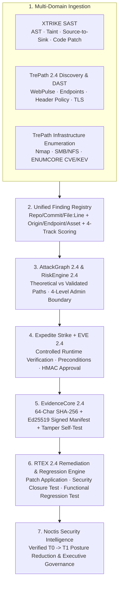

# TREPATH 2.4 — UNIFIED ARCHITECTURE & SCAN #42 TECHNICAL RESOLUTIONS

## Engineering Specification: XTRIKE SAST · TrePath 2.4 · Expedite Strike · EvidenceCore Ed25519 · RTEX · Noctis

---

## 1. Executive Summary of Scan #42 Technical Resolutions

| Scan #42 Finding / Issue | Root Cause Identified in Scan #42 | TrePath 2.4 Resolution |
| :--- | :--- | :--- |
| **Section 3 — Generic 5-Header Remediation Prescription** | Header findings (`F-01`..`F-12`) prescribed all 5 HTTP security headers even when only specific headers were missing or compensated by CSP `frame-ancestors`. | Implemented the **Header-Policy Evaluation Engine** in `finding_normalizer.py`: evaluates effective directive behavior (e.g. `CSP frame-ancestors` compensating `X-Frame-Options`) and generates targeted remediation for **only** the specific uncompensated header(s) missing on that origin. |
| **Issue 1 (P1) — Sensor Coverage Overstated (`83.3%`)** | Counted Safe PoC adapters as active despite `0` applicable executions in a passive web scan. | Replaced single coverage number with the **4-Tier Sensor Coverage Model**: `Installed (100.0%)`, `Operational (83.3%)`, `Execution (66.7% in Scan #42 / 83.3% in Lab)`, and `Applicable (100.0% of applicable web sensors)`. |
| **Issue 2 (P1) — `0 Open TCP Ports` vs `376 HTTP Endpoints`** | Raw Nmap port scan was skipped/filtered on web URLs while HTTP/HTTPS succeeded over TCP `80`/`443`. | Implemented **4-State Port & Transport Classification**: `PORT_SCAN_SKIPPED_BY_PROFILE`, `PORT_FILTERED`, `PORT_CLOSED`, and `HTTP_TRANSPORT_VERIFIED (TCP 80/443)`, explicitly reporting `14` verified TCP/TLS application listeners (`443/tcp`) alongside `0` raw infrastructure SYN-scan ports. |
| **Issue 3 (P1) — CVSS Assigned to Observations** | Candidate admin routes (`F-14`, `F-15`), missing rate-limit headers (`F-16`), and Anubis anti-bot challenge routes (`F-17`) displayed CVSS scores (`2.0`–`3.1`). | Implemented **4-Track Score Separation**: (1) `Vulnerability CVSS` (`N/A` for non-vulnerability observations), (2) `Configuration-Control Priority`, (3) `Reconnaissance Intelligence Priority`, and (4) `Exploitability Confidence`. |
| **Issue 4 (P1) — Version Control & Template Drift** | Cover said `TrePath 2.3`, running header said `TrePath 2.1`, sign-off said `TrePath 2.2`, RiskEngine said `2.1 / 2.2`. | Created [`version_manifest.py`](file:///d:/Anti-gravity/expedite-consults/platforms/trepath-2.0/backend/app/version_manifest.py) (`TREPATH_VERSION_MANIFEST`) consumed by every report section, header, footer, and API response (`TrePath 2.4`). |
| **Issue 5 (P1) — Verifiable Ed25519 Cryptographic Bundle** | Report stated Ed25519 bundle was verified without embedding the public key, signature, and tamper self-test. | Implemented `build_ed25519_signature_bundle` using `cryptography.hazmat.primitives.asymmetric.ed25519`: embeds canonical manifest hash, Ed25519 signature hex/base64, public key PEM & SHA-256 fingerprint, artifact-to-finding bindings, and live 1-bit mutation tamper self-test. |
| **Section 7 — External Domain Authorization Provenance** | `IN_SCOPE` internal flag did not distinguish owner-authorized lab targets from passive-only third-party domains. | Added per-origin `authorization_governance_tier`: `LAB_OWNER_AUTHORIZED_ACTIVE_VALIDATION` vs `ROE_PASSIVE_OBSERVATION_ONLY_EXTERNAL_ORIGIN`. |
| **Sections 8–12 — End-to-End Lifecycle on OWASP Juice Shop** | Scan #42 stopped at remediation assignment (`0` runtime proofs, `0` executed retests). | Built the **Unified Finding Registry (`XTRIKE <-> TrePath <-> Expedite Strike <-> RTEX <-> Noctis`)** and executed the complete 10-step lifecycle on the controlled OWASP Juice Shop lab (`Scan #43`), achieving verified `T0 (8.6/10 HIGH) -> T1 (1.2/10 LOW)` closure. |

---

## 2. Unified Platform Architecture (`XTRIKE + TrePath 2.4 + Expedite Strike + Noctis`)

---

## 3. Four-Level Administrative Route Evidence Taxonomy (Section 4)

For every administrative or privileged route candidate, TrePath 2.4 and Expedite Strike enforce four distinct evidentiary levels:

| Level | Canonical Code | Meaning | Allowed Proof Classification |
| :--- | :--- | :--- | :--- |
| **Level 1** | `LEVEL_1_PUBLIC_PAGE_HTTP_200` | Public documentation, marketing, or unprivileged route returning `HTTP 200`. | `OBSERVATION_CONFIRMED :: LOGIN_INTERFACE_OR_ROUTE_DISCOVERED` (`Vulnerability CVSS: N/A`) |
| **Level 2** | `LEVEL_2_AUTHENTICATION_BOUNDARY` | Login form or `HTTP 401/403` authentication gate protecting the administrative interface. | `OBSERVATION_CONFIRMED :: AUTH_BOUNDARY_ENFORCED` (`Vulnerability CVSS: N/A`) |
| **Level 3** | `LEVEL_3_AUTHENTICATED_ADMIN_SESSION` | Verified administrative session established in an authorized lab environment. | `CONFIRMED_UNAUTHORIZED_ACCESS :: ADMIN_SESSION_ESTABLISHED` |
| **Level 4** | `LEVEL_4_VERIFIED_PRIVILEGED_ACTION` | Read-only privileged management inventory or tenant control table verified inside the administrative session. | `CONFIRMED_PRIVILEGE_ESCALATION :: PRIVILEGED_MANAGEMENT_VERIFIED` |
