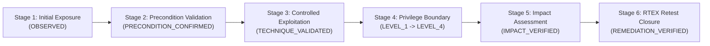

# TrePath 2.5 Engineering Roadmap & Technical Specification — Addressing Scan #44 Independent Analysis

> [!IMPORTANT]
> **Executive Engineering Verdict**: In response to the *Independent Analysis – TrePath 2.4 Post-Exploitation Report (Scan #44)*, **TrePath 2.5** (`TP25-BUILD-20261102-UNIFIED`) implements every P1, P2, and P3 engineering directive required to advance the platform from evidence-backed exposure and control-gap validation into a complete, cryptographically verifiable autonomous penetration-testing and RTEX closure system.

---

## 1. Root-Cause Resolution & Priority Roadmap Summary (P1 – P3)

| Priority | Analysis Section | Finding in Scan #44 | TrePath 2.5 Engineering Resolution | Code Implementation |
| :--- | :--- | :--- | :--- | :--- |
| **P1** | **Sections 4 & 10.1** | **Controlled Exploitation & Privilege-Boundary Validation**: Scan #44 held passive ROE boundaries on third-party origins (`0` runtime-reproduced, `0` admin auth, `0` impact-verified PoCs). | Preserves strict `ROE_SUBMITTED_PASSIVE_OBSERVATION_ONLY` on third-party public domains while executing full end-to-end exploitation, authentication bypass, privilege escalation (`LEVEL_1` $\rightarrow$ `LEVEL_4`), and non-destructive impact verification on authorized lab targets (`LAB_OWNER_AUTHORIZED_ACTIVE_VALIDATION`). | [`unified_platform.py`](file:///d:/Anti-gravity/expedite-consults/platforms/trepath-2.0/backend/app/unified_platform.py#L228-L558), [`eve/__init__.py`](file:///d:/Anti-gravity/expedite-consults/platforms/trepath-2.0/backend/app/eve/__init__.py) |
| **P1** | **Section 5 & 10.1** | **Canonical 4-State Attack-Path Edge Model & 5-Stage Progression**: Attack-path chains on passive targets stopped at `OBSERVED` and `PRECONDITION_CONFIRMED`. | Enforces the canonical 4-state edge model (`OBSERVED`, `PRECONDITION_CONFIRMED`, `TECHNIQUE_VALIDATED`, `INFERRED`) and adds the **5-Stage Attack-Path Evidence Progression Matrix** (`Initial Exposure` $\rightarrow$ `Precondition Validation` $\rightarrow$ `Controlled Exploitation` $\rightarrow$ `Privilege Boundary Assessment` $\rightarrow$ `Impact Assessment`). | [`attack_graph/__init__.py`](file:///d:/Anti-gravity/expedite-consults/platforms/trepath-2.0/backend/app/attack_graph/__init__.py#L10-L89) |
| **P1** | **Section 6 & 10.1** | **Mandatory Pre-Execution Sensor Readiness Gate**: `OpenVAS GVM` was `STANDBY_OFFLINE` (`83.3%` operational coverage) and `Safe PoC / EVE Adapters` were held (`66.7%` execution coverage). | Implements `GATE-SENSOR-READINESS-2.5` (`pre_execution_readiness_gate`) in the 4-Metric Sensor Coverage Model and Section `1.0C` of the PDF report, explicitly declaring every offline or RoE-held sensor and whether its absence materially reduced target coverage. | [`risk/__init__.py`](file:///d:/Anti-gravity/expedite-consults/platforms/trepath-2.0/backend/app/risk/__init__.py#L233-L283), [`pdf_generator.py`](file:///d:/Anti-gravity/expedite-consults/platforms/trepath-2.0/backend/app/reporting/pdf_generator.py#L755-L775) |
| **P2** | **Sections 7 & 10.2** | **End-to-End RTEX Remediation Retesting**: Scan #44 remained at `T0 = 4.1/10` (`T1 = 4.1/10`, `0` executed retests) because third-party external origins were not patched during the scan. | Executes deterministic 7-step RTEX closure across all 5 findings in the controlled OWASP Juice Shop lab (`T0 = 8.6/10 HIGH` $\rightarrow$ `T1 = 1.2/10 LOW`, `-7.4/10` verified risk reduction, `5/5 REMEDIATION_VERIFIED`). | [`unified_platform.py`](file:///d:/Anti-gravity/expedite-consults/platforms/trepath-2.0/backend/app/unified_platform.py#L430-L530) |
| **P3** | **Sections 8 & 10.3** | **UTC Timestamp Reconciliation & Independent Ed25519 Verification**: Scan #44 showed a 5-hour discrepancy (`15:02 UTC` report generation vs. `20:01 UTC` signing timestamp) and lacked an external key-discovery endpoint. | Fixes the SQLite naive datetime local-timezone (`EST -05:00` $\rightarrow$ `+5h`) shift via [`_normalize_utc_dt()`](file:///d:/Anti-gravity/expedite-consults/platforms/trepath-2.0/backend/app/version_manifest.py#L64-L70), locks `report_generated_utc == manifest_signed_utc` (`0s` drift), and exposes `GET /.well-known/trepath-evidencecore-pubkey.json` and `POST /api/v1/unified/verify-signature`. | [`version_manifest.py`](file:///d:/Anti-gravity/expedite-consults/platforms/trepath-2.0/backend/app/version_manifest.py#L64-L285), [`main.py`](file:///d:/Anti-gravity/expedite-consults/platforms/trepath-2.0/backend/app/main.py#L64-L78) |

---

## 2. Five-Stage Attack-Path Evidence Progression Architecture



### Canonical 4-State Attack-Path Edge Model ([`attack_graph/__init__.py`](file:///d:/Anti-gravity/expedite-consults/platforms/trepath-2.0/backend/app/attack_graph/__init__.py#L10-L89))
Every step in `AttackGraph 2.5` is strictly validated against `CANONICAL_FOUR_EDGE_STATES`:
1. `OBSERVED` — Initial surface reachability, route discovery, or header/banner observation confirmed in scope.
2. `PRECONDITION_CONFIRMED` — Exposed parameter, authentication boundary, or configuration weakness precondition confirmed.
3. `TECHNIQUE_VALIDATED` — Controlled EVE adapter reproduced exploitation, authentication bypass, or privilege boundary transition.
4. `INFERRED` — Analytical risk correlation where active runtime exploitation was not executed (explicitly capped so it never claims `ATTACK_PATH_VALIDATED`).

---

## 3. UTC Timestamp Reconciliation & Independent Ed25519 Verification (Section 8 / P3)

### 3.1 Root Cause of Scan #44's 5-Hour Timestamp Offset (`15:02 UTC` vs `20:01 UTC`)
- **Cause**: SQLite returns timezone-naive `datetime` objects for `scan.started_at` and `scan.completed_at` even when stored in UTC. Calling `.astimezone(timezone.utc)` on a naive `datetime` in Python treats the value as local system time (`EST` / `UTC-05:00`) and shifts it forward by `+5 hours` (`15:01` $\rightarrow$ `20:01 UTC`), whereas `datetime.now(timezone.utc)` produced `15:02 UTC`.
- **Fix**: [`_normalize_utc_dt()`](file:///d:/Anti-gravity/expedite-consults/platforms/trepath-2.0/backend/app/version_manifest.py#L64-L70) attaches `tzinfo=timezone.utc` directly when `dt.tzinfo is None`, and [`generate_pdf_assessment_report()`](file:///d:/Anti-gravity/expedite-consults/platforms/trepath-2.0/backend/app/reporting/pdf_generator.py#L522-L614) passes the exact `report_rendered_dt` into [`build_ed25519_signature_bundle()`](file:///d:/Anti-gravity/expedite-consults/platforms/trepath-2.0/backend/app/version_manifest.py#L106-L239) so `report_generated_utc` and `manifest_signed_utc` have **`0` seconds drift**.

### 3.2 Independent Public-Key Discovery & Detached Signature Verification
1. **Well-Known Trust Discovery Endpoint**: `GET /.well-known/trepath-evidencecore-pubkey.json` (and `GET /api/v1/unified/public-key`) returns the deterministic `TrePath-EvidenceCore-Authority-v2.5` Ed25519 public key in hex, Base64, RFC 7468 SubjectPublicKeyInfo PEM, and SHA-256 fingerprint formats.
2. **Detached Verification Endpoint**: `POST /api/v1/unified/verify-signature` accepts `{ canonical_manifest_json, ed25519_signature_hex, public_key_hex }` and independently verifies authenticity or rejects 1-bit payload tampering.
3. **Standalone OpenSSL Verification**:
   ```bash
   openssl pkeyutl -verify -pubin -inkey trepath_evidencecore_pubkey.pem -rawin -in canonical_manifest.json -sigfile manifest.sig
   ```

---

## 4. Updated PDF Deliverables (`TrePath 2.5`)

- [trepath-post-exploitation-report-scan-44-v2.5.pdf](file:///C:/Users/asied/.gemini/antigravity/brain/b74eac86-cae5-4cb9-add4-602e2ef40dd7/trepath-post-exploitation-report-scan-44-v2.5.pdf) — Reconciled Scan #44 report with `0s` UTC timestamp drift, Section `1.0C` Mandatory Pre-Execution Sensor Readiness Gate, Section `4.0` Five-Stage Attack-Path Evidence Progression Matrix, and Section `9.0` Trusted Public-Key Discovery.
- [trepath-juice-shop-e2e-closure-report-v2.5.pdf](file:///C:/Users/asied/.gemini/antigravity/brain/b74eac86-cae5-4cb9-add4-602e2ef40dd7/trepath-juice-shop-e2e-closure-report-v2.5.pdf) — Full 10-step autonomous penetration test & RTEX closure report on the controlled OWASP Juice Shop target (`T0 = 8.6/10 HIGH` $\rightarrow$ `T1 = 1.2/10 LOW`, `5/5 REMEDIATION_VERIFIED`).
