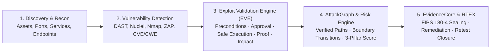

# TREPATH 2.3 — EXPLOIT VALIDATION ENGINE (EVE)

## Engineering Specification, Architecture & Implementation Reference

**Version**: `TrePath 2.3 / EVE-1.0`  
**Service Compatibility**: Reusable shared engine for **TrePath 2.3** and **Expedite Strike**  
**Baseline Scans**: Scan #41 (`46` URLs -> `14` In-Scope Origins, `17` Consolidated Findings) & Scan #35 (`192.168.195.139` Controlled Linux Vulnerability Lab)

---

## 1. Architectural Placement in TrePath 2.3

EVE introduces a dedicated, deterministic **Stage 3: Exploit Validation Engine** between Vulnerability Detection and AttackGraph/Risk calculation:

### The Four-Tier Platform Distinction Enforced by EVE

| Platform Tier | Canonical Tier Code | Definition | Required Evidence |
| :--- | :--- | :--- | :--- |
| **1. Vulnerability Detected** | `VULNERABILITY_DETECTED` | A scanner identifies a possible weakness, missing control, or banner/CVE correlation. | Raw sensor observation + scope provenance (`IN_SCOPE`). |
| **2. Exploitability Validated** | `EXPLOITABILITY_VALIDATED` | Necessary preconditions exist and a controlled, approved EVE test deterministically reproduces the behavior. | Precondition record + signed approval + non-destructive execution transcript (`PRECONDITION_VALIDATED` / `RUNTIME_REPRODUCED`). |
| **3. Impact Verified** | `IMPACT_VERIFIED` | The controlled test establishes a concrete security boundary violation (`CONFIRMED_UNAUTHORIZED_ACCESS`, `CONFIRMED_PRIVILEGE_ESCALATION`, `IMPACT_VERIFIED`). | Verified impact record + expected-vs-actual boundary proof sealed in EvidenceCore. |
| **4. Remediation Verified** | `REMEDIATION_VERIFIED` | A subsequent RTEX retest proves that the weakness has been remediated and the boundary now holds. | Post-fix RTEX transcript (`T1`) linked to original `T0` artifact. |

---

## 2. Nine-Stage EVE Exploitation Lifecycle

1. **Stage 1 — Finding Ingestion (`ExploitOrchestrator.ingest_finding`)**:
   - Ingests a `models.Finding` alongside its canonical `models.Asset`, `effective_origin`, `endpoint`, `service`, `port`, `cve_id`/`cwe_id`, and `EvidenceArtifact`.
   - Verifies explicit ROE authorization and asset provenance. Findings lacking valid `IN_SCOPE` provenance immediately transition to `OUT_OF_SCOPE_BLOCKED`.
2. **Stage 2 — Exploitability Analysis (`ExploitIntelligenceService` + `ExploitPreconditionAnalyzer`)**:
   - Classifies the vulnerability family, resolves affected technology/version/configuration, evaluates CVE/CWE/NVD/KEV/ExploitDB metadata, and separates **exploit availability** (`public_exploit_exists`) from **target exploitability** (`preconditions_satisfied`).
   - Computes independent `evidence_confidence`, `exploitability_confidence`, and `impact_confidence` scores (`0.0`–`1.0`).
3. **Stage 3 — Exploit Validation Planning (`ExploitAdapterRegistry` + `ExploitOrchestrator.plan_job`)**:
   - Selects a deterministic adapter (`EVE-AUTH-001`, `EVE-AUTHZ-001`, `EVE-INJ-001`, `EVE-FILE-001`, `EVE-NET-001`, etc.), defines exact validation objectives, permitted HTTP/TCP actions, `max_requests` (`<= 10`), `timeout_seconds` (`<= 15s`), and safety profile (`READ_ONLY_DETERMINISTIC`).
   - Enforces cryptographic HMAC approval tokens (`ExploitExecutionApproval`) before execution.
4. **Stage 4 — Controlled Exploit Execution (`SafeExecutionWorker`)**:
   - Runs approved, non-destructive, read-only validation probes inside strict rate/timeout/egress guardrails.
   - Supports immediate `emergency_stop()` preemption and automatic post-test `cleanup()`.
5. **Stage 5 — Impact Verification (`ImpactVerificationEngine`)**:
   - Evaluates 10 canonical impact categories (`UNAUTHORIZED_ACCESS`, `AUTHENTICATION_CONTROL_FAILURE`, `AUTHORIZATION_BYPASS`, `PRIVILEGE_ESCALATION`, `SENSITIVE_DATA_EXPOSURE_SYNTHETIC`, `ISOLATED_RCE_PROOF`, `CONTROLLED_SSRF_CALLBACK`, `DETERMINISTIC_INJECTION_PROOF`, `SECURITY_BOUNDARY_VIOLATION`, `ANALYTICAL_DOS_EXPOSURE`).
6. **Stage 6 — Evidence Collection (`EvidenceCoreIntegration`)**:
   - Captures all 15 mandatory fields, computes a canonical SHA-256 transcript digest, detects replay or transcript tampering, and seals the record in `evidence_artifacts` and `exploit_evidence_records`.
7. **Stage 7 — Proof Classification (`ExploitProofValidator`)**:
   - Enforces the 12 EVE proof states (`DISCOVERED`, `OBSERVATION_CONFIRMED`, `PRECONDITION_VALIDATED`, `EXPLOIT_ATTEMPTED`, `RUNTIME_REPRODUCED`, `CONFIRMED_UNAUTHORIZED_ACCESS`, `CONFIRMED_PRIVILEGE_ESCALATION`, `IMPACT_VERIFIED`, `EXPLOITATION_FAILED`, `INCONCLUSIVE`, `NOT_APPLICABLE`, `OUT_OF_SCOPE_BLOCKED`) and records every transition in `exploit_state_transitions`.
8. **Stage 8 — AttackGraph Integration (`AttackGraphIntegration`)**:
   - Connects validated findings to affected assets, distinguishes `THEORETICAL` from `EXECUTED_AND_VERIFIED` attack paths, records `source_asset`, `destination_asset`, `actor_identity`, `evidence_reference`, and `attack_path_confidence`, and prohibits lateral movement inference from network reachability alone.
9. **Stage 9 — Reporting & RTEX (`ExploitRiskScoringEngine` + `RTEXIntegration`)**:
   - Updates the original finding only when backed by verified proof, syncs origin-bound remediation tasks, and hands off to RTEX.

---

## 3. Canonical Database Schema (11 EVE Entities)

| Table Name | SQLAlchemy Model | Purpose |
| :--- | :--- | :--- |
| `exploit_validation_jobs` | `ExploitValidationJob` | Master asynchronous job state, 4-tier platform status, confidence triad, and immutable references to `scan_id`, `finding_id`, `asset_id`. |
| `exploit_adapter_registry` | `ExploitAdapterRecord` | Registered deterministic validation adapters across all 15 vulnerability categories. |
| `exploit_preconditions` | `ExploitPrecondition` | Stage 2 precondition checklist, CVE/KEV/ExploitDB correlation, and `exploit_availability` vs `exploitability` separation. |
| `exploit_execution_attempts` | `ExploitExecutionAttempt` | Independent record of every controlled execution run, request count, duration, transcript hash, and worker telemetry. |
| `exploit_execution_approvals` | `ExploitExecutionApproval` | Operator approval ledger with cryptographic `approval_token_sha256` binding `job_id + finding_id + asset_id + adapter_id + max_requests`. |
| `exploit_proof_results` | `ExploitProofResult` | Stage 7 proof classification decision, prior state, new EVE state, and transition rule rationale. |
| `exploit_impact_results` | `ExploitImpactResult` | Stage 5 per-category boundary and impact verification outcomes. |
| `exploit_evidence_records` | `ExploitEvidenceRecord` | Stage 6 15-field forensic package linked to `evidence_artifacts.id` with replay/tamper verification. |
| `exploit_state_transitions` | `ExploitStateTransition` | Immutable state-machine transition log (`from_state -> to_state`) with evidence gate citations. |
| `exploit_cleanup_records` | `ExploitCleanupRecord` | Post-execution cleanup verification confirming zero residual state on the target asset. |
| `exploit_audit_events` | `ExploitAuditEvent` | Tamper-evident audit trail for every ingestion, approval, execution, emergency stop, and verification action. |
